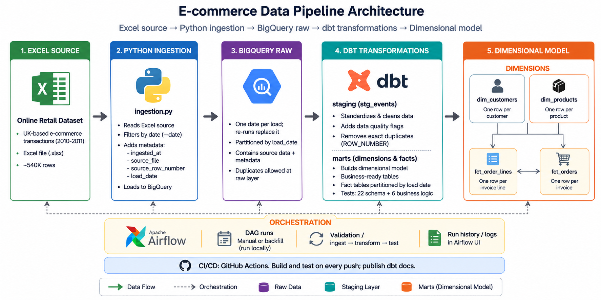
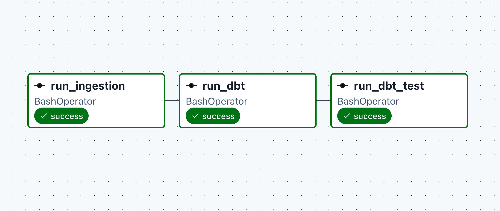
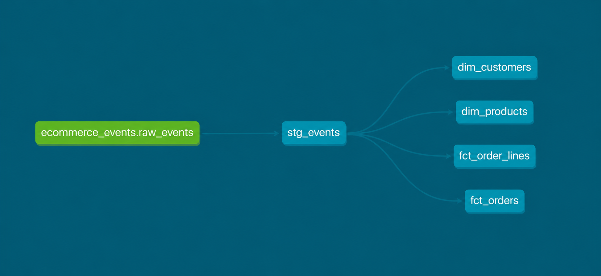
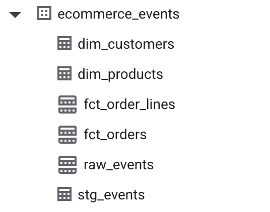

# E-commerce Data Pipeline

> An end-to-end data pipeline that ingests e-commerce transaction data, transforms it through a dimensional warehouse, and orchestrates daily batch processing. Built as a portfolio project to demonstrate incremental loading, deduplication, automated testing, and workflow orchestration using modern data engineering tools.

**Tech Stack:** Python • BigQuery • dbt • Apache Airflow

**Dataset:** [Online Retail Dataset](https://archive.ics.uci.edu/dataset/352/online+retail) - 541,000+ transactions from a UK online retailer (2010-2011). The pipeline has been run on December 2010 (42,481 rows, 20 trading days); the same backfill process loads any date range.

---

## Architecture

### System Diagram


### Data Flow

**1. Ingestion Layer**
Python script extracts transactions for a specific date from Excel source, adds metadata (ingested_at, source_file, load_date), and loads to BigQuery raw_events table (partitioned by load_date). Re-running a date replaces it (idempotent load).

**2. Staging Layer**
dbt transforms raw data: standardizes formatting (UPPER, TRIM), adds quality flags (negative quantities, missing customer IDs), calculates derived fields (line_value), and deduplicates using window functions (removing rows that are identical across all business columns, keeping the most recent ingestion).

**3. Marts Layer**
dbt builds dimensional model:
- **Dimensions:** dim_products (one row per stock_code), dim_customers (one row per customer_id, excludes guests)
- **Facts:** fct_order_lines (transaction-level detail), fct_orders (order-level aggregates)

### Warehouse Design

**Dimensional Model:**

Raw → Staging → Marts (Dimensions + Facts)

**Key Design Principles:**
- Raw layer accepts all data (no filtering)
- Staging layer cleans and flags issues (removes exact duplicates)
- Dimensions contain descriptive attributes (who, what, where)
- Facts contain metrics and foreign keys (how much, when)
- Quality flags enable filtered analysis without data loss

---

## Key Features

### ✅ Incremental Data Ingestion
Ingestion script processes one date at a time rather than loading the entire dataset at once. Enables reprocessing of individual dates, and mirrors production batch job patterns. Re-running a date replaces it (idempotent load). Airflow orchestrates sequential date processing via backfill commands.

### ✅ Deduplication Logic
Source data for December 2010 contains 500 exact duplicate rows. Raw layer accepts all data; staging layer deduplicates using `ROW_NUMBER()` window functions partitioned by all business columns, keeping the most recent ingestion. This handles both source duplicates and accidental pipeline re-runs, while keeping genuine repeat lines (the same product appearing more than once on an invoice with different quantities). An earlier version used a narrower key and wrongly removed 170 genuine lines; see BUILD_NOTES.md.

### ✅ Automated Data Quality Testing
28 dbt tests run on every pipeline run:
- **22 schema tests:** primary key uniqueness and completeness, required fields
- **6 business logic tests:** staging reconciles to raw, line values and order totals add up, one customer and one date per invoice, totals have the right sign for the invoice type

Airflow runs the tests as the final pipeline step (ingest → transform → test). If any test fails, the run fails before the data is used.

### ✅ Workflow Orchestration
Airflow runs ingest → transform → test, each step only if the previous one succeeded. Ingestion retries twice on failure; tests don't, as a failed test means bad data, not a temporary fault. Runs are triggered manually or by backfill (the daily schedule is switched off, as Airflow runs locally).

### ✅ CI/CD and Published Documentation
Every push to `main` triggers a GitHub Actions workflow that rebuilds all models and runs all 28 tests in a separate CI dataset, so code changes are checked without touching the main tables. If everything passes, it generates the dbt docs and publishes them to GitHub Pages. [View the live docs](https://dominicbarry.github.io/ecommerce-data-pipeline/).

### ✅ Dimensional Modeling
Star schema with 2 dimensions (products, customers) and 2 fact tables (order lines, orders). Separates descriptive attributes from metrics, optimizes for analytical queries.

---

## Design Decisions & Trade-offs

**Why dimensional modeling?**
Separates descriptive attributes from metrics, enabling efficient aggregation queries. Trade-off: More complex setup, simpler long-term analysis.

**Why deduplicate in staging, not ingestion?**
Raw layer = immutable audit trail. Staging handles deduplication, allowing reprocessing with different rules. Trade-off: aw keeps source duplicates, so anything reading raw directly must deduplicate.

**Why full-refresh dbt?**
Dataset size manageable, simpler implementation, ensures dimensional consistency. Trade-off: Longer transforms vs. incremental complexity.

**Other choices:**
- Local Airflow (zero cost for learning; production would use cloud)
- Quality flags vs. dropping bad rows (preserves data, requires analyst filtering)

---

## Technologies

| Component | Technology | Purpose |
|-----------|-----------|---------|
| Ingestion | Python + Pandas | Extract and load from Excel to BigQuery |
| Warehouse | Google BigQuery | Cloud data warehouse |
| Transformation | dbt | SQL-based transformations, testing, documentation |
| Orchestration | Apache Airflow | Workflow scheduling and monitoring |
| Version Control | Git | Code management |
| CI/CD | GitHub Actions | Builds and tests every push in a separate dataset |
| Documentation | dbt docs + GitHub Pages | Model, column and lineage docs, republished on every push |

---

## Repository Structure
```
ecommerce-data-pipeline/
├── .github/workflows/      # CI: build, test and publish docs on every push
├── src/                    # Python ingestion script
├── ecommerce_dbt/          # dbt project
│   ├── models/
│   │   ├── staging/        # Cleaning and deduplication
│   │   └── marts/          # Dimensional model (dims + facts)
│   ├── tests/              # Business logic tests
│   └── ci/                 # dbt profile used by CI
├── airflow/dags/           # Orchestration DAG
├── data/                   # Source data (Excel)
├── screenshots/            # Images used in this README
└── sql/                    # Legacy SQL scripts (pre-dbt)
```

## Running It Locally

Requires Python 3.12 and a Google Cloud project with BigQuery (EU location).

```bash
# 1. Set up the environment
python -m venv .venv
source .venv/bin/activate
pip install -r requirements.txt

# 2. Log in to Google Cloud
gcloud auth application-default login

# 3. Create the raw table: run sql/01_create_raw_events.sql in BigQuery

# 4. Load one day and build the warehouse
python src/ingestion.py --date 2010-12-01
cd ecommerce_dbt
dbt build      # builds all models and runs all tests
```

dbt needs a profile named `ecommerce_dbt` in `~/.dbt/profiles.yml` (BigQuery, `oauth`, dataset `ecommerce_events`).

To run through Airflow instead, set `AIRFLOW_HOME` to the repo's `airflow/` folder, run `airflow standalone`, and backfill a date range:
```bash
airflow backfill create --dag-id ecommerce_etl --from-date 2010-12-01 --to-date 2010-12-31 --max-active-runs 1
```

Note: the project ID is set in `src/ingestion.py` and `sources.yml`, and the DAG uses local paths, so these need changing to run it elsewhere.

---

## Screenshots

### Airflow DAG Execution

*Ingestion, transformation and testing run in sequence; a failed test fails the run*

### dbt Lineage Graph

*Data flow from staging through dimensional model*

### BigQuery Dimensional Model

*Dimensional model in BigQuery*

---

## Contact

Dominic Barry  
[LinkedIn](https://www.linkedin.com/in/dom-barry/) • [Portfolio](https://dominicbarry.github.io/portfolio) • [GitHub](https://github.com/DominicBarry)